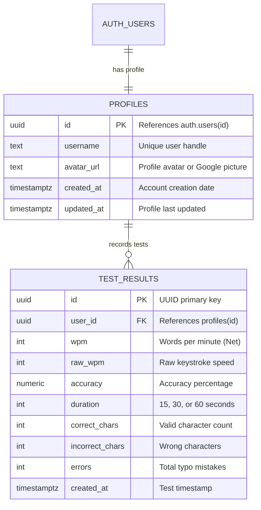

# ⚡ TypeSpeed 1.0

### **A Modern, Fast, and Competitive Typing Speed & Accuracy Platform**

  <b>Test your typing speed, improve accuracy, compete on global leaderboards, and sync your statistics across all devices.</b>

[Live Demo](https://typespeed1.vercel.app/) • [Features](#-features) • [Tech Stack](#-tech-stack) • [Database Architecture](#-database-architecture) • [Getting Started](#-getting-started)

---

## 📖 About TypeSpeed

**TypeSpeed** is a high-performance, real-time typing speed test web application built for typists, programmers, and enthusiasts looking to sharpen their keystroke velocity and accuracy.

Unlike simple client-only typing tests that lose your progress once the browser tab closes, **TypeSpeed is supercharged with a full cloud backend powered by Supabase and PostgreSQL**. It enables users to securely sign in (via Email or Google OAuth), automatically record their test history, analyze performance metrics, and compete for the #1 spot on global real-time leaderboards.

---

## ✨ Features

### 🚀 Core Typing Engine
- **Ultra-Fluid Typing Experience**: High-precision 50ms interval clock tracking with zero keystroke latency.
- **Dynamic Passage Generation**: Curated typing passages across Technology, Science, Productivity, Philosophy, and Literature with automatic passage expansion for ultra-fast typists.
- **Comprehensive Metrics**: Live WPM, Raw WPM, Accuracy %, Total Keystrokes, and Error Tracking calculated in real time.
- **Flexible Test Durations**: Switch seamlessly between **15s**, **30s**, and **60s** sprint modes.
- **Micro-Animations & Audio Feedback**: Optional typewriter audio clicks for keypresses and celebratory confetti explosions on new personal bests.

### 🔐 Authentication & Security
- **Dual Authentication System**:
  - **Email & Password**: Direct signup and login with instant validation.
  - **Google OAuth One-Click Sign-In**: Quick sign-in syncing user's Google display name and profile picture.
- **Session Persistence**: Secure JSON Web Token (JWT) handling with automatic background token refreshes via Supabase Auth.
- **Row Level Security (RLS)**: PostgreSQL-level data access policies ensuring users can only modify their own typing scores.

### ☁️ Cloud Database & Analytics
- **Cloud-Synced Personal Bests**: Automatically tracks all-time highest WPM, best accuracy, and total tests taken.
- **Guest-to-User Score Migration**: Allows users to take tests as a guest, and automatically imports their local records into the cloud once they sign in.
- **Customizable Profiles**: Inline profile username editor allowing users to claim their unique handle on the leaderboard.

### 🏆 Global Leaderboard
- **Competitive Rankings**: Top typists globally ranked with gold (🥇), silver (🥈), and bronze (🥉) medals.
- **Duration Filtering**: Filter leaderboard entries by 15-second, 30-second, or 60-second test categories.
- **Live Sync**: Refreshes rankings on-demand with direct SQL queries.

### 🎨 Modern UI & UX Design
- **Tailwind CSS v4 & Glassmorphism**: Clean dark and light theme toggle with smooth transitions.
- **Responsive Layout**: Designed for mobile, tablet, and desktop viewports.

---

## 🛠️ Tech Stack

| Category | Technology | Purpose |
| :--- | :--- | :--- |
| **Frontend Library** | [React 19](https://react.dev/) | Component architecture & state hooks |
| **Language** | [TypeScript 5.8](https://www.typescriptlang.org/) | Strict type safety and database schemas |
| **Build Tool** | [Vite 6](https://vitejs.dev/) | Lightning-fast HMR and production bundle optimization |
| **Styling** | [Tailwind CSS v4](https://tailwindcss.com/) | Modern utility-first responsive styling |
| **Icons & Visuals** | [Lucide React](https://lucide.dev/) | Crisp iconography |
| **Celebrations** | [Canvas Confetti](https://www.npmjs.com/package/canvas-confetti) | Milestone and PB celebration effects |
| **Backend & Auth** | [Supabase](https://supabase.com/) | BaaS for Authentication, OAuth, and API layer |
| **Database** | [PostgreSQL](https://www.postgresql.org/) | Relational storage for profiles, test results, and leaderboards |
| **Deployment** | [Vercel](https://vercel.com/) | Global edge hosting and automated CI/CD deployments |

---

## 🗄️ Database Architecture

TypeSpeed utilizes a relational PostgreSQL database on Supabase structured with security and fast indexing:

### Key Database Features:
- **Automatic User Trigger (`handle_new_user`)**: Listens for new auth registrations (Email or Google OAuth) and automatically creates the profile row with a unique username and avatar.
- **Optimized Indexes**: B-Tree indexes on `test_results(wpm DESC)` and `test_results(duration, wpm DESC)` for sub-millisecond leaderboard queries.
- **Global Leaderboard View (`public.leaderboard`)**: High-performance SQL view computing each user's top score grouped by test duration.

---

## 🚀 How to Use the Live Website

**TypeSpeed** is live and ready to use in your browser. No local setup or installation required!

### 1. Launch the Application
Open the live deployment in your browser:
👉 **[Open TypeSpeed on Vercel](https://typespeed1.vercel.app/)**

### 2. Sign In or Create an Account
* Click **"Sign In"** in the top navigation bar.
* Choose **"Continue with Google"** for instant 1-click access, or sign up with your **Email & Password**.
* Your personal bests, history, and leaderboard rankings are automatically tied to your account.

### 3. Take a Typing Speed Test
* Select your preferred test duration: **15s**, **30s**, or **60s**.
* Click into the passage area and start typing immediately — the precision clock starts on your very first keystroke.
* Toggle keyboard sound effects on/off using the sound button in the controls bar.

### 4. View Analytics & Climb the Global Leaderboard
* Upon completing each test, view your detailed performance breakdown: **Net WPM**, **Raw WPM**, **Accuracy %**, and **Error count**.
* High scores are automatically saved to your cloud profile in real time.
* Click **"Leaderboard"** in the header to compare your speed with typists around the world!

### 5. Customize Your Profile
* Click your user avatar in the header to view your tests completed and highest WPM.
* Click the **pencil icon (✏️)** next to your username to set your custom display name on the leaderboard.

---

## 📄 License
This project is open-source and available under the [MIT License](LICENSE).

  <b>Built with ❤️ by Tejas Namde</b>

